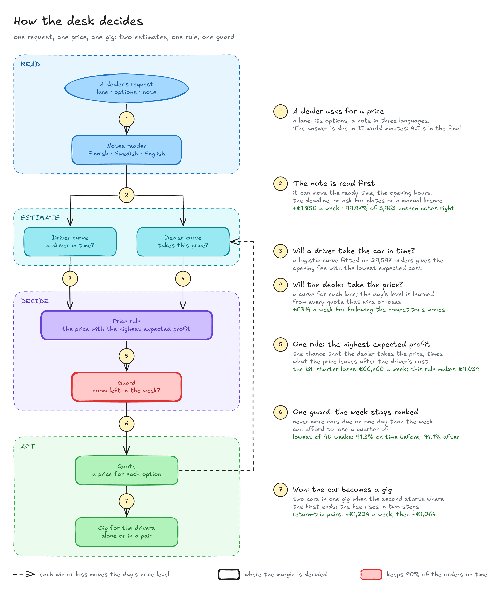
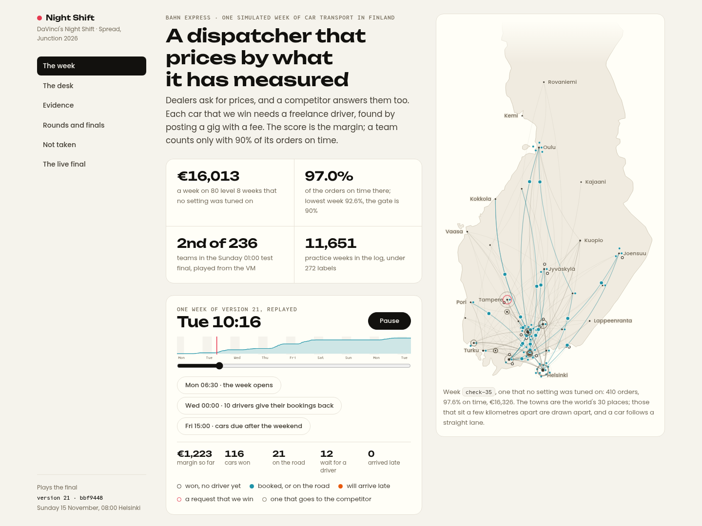
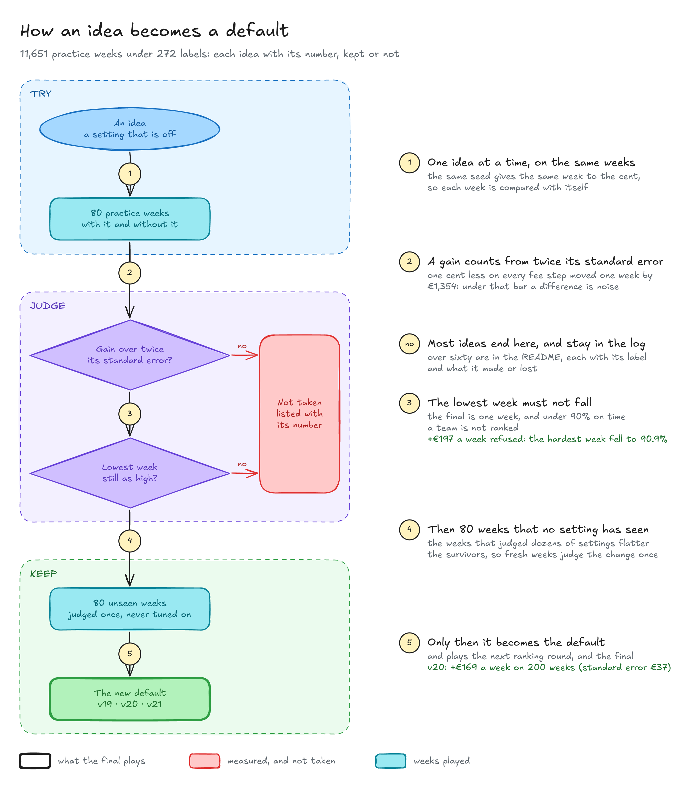
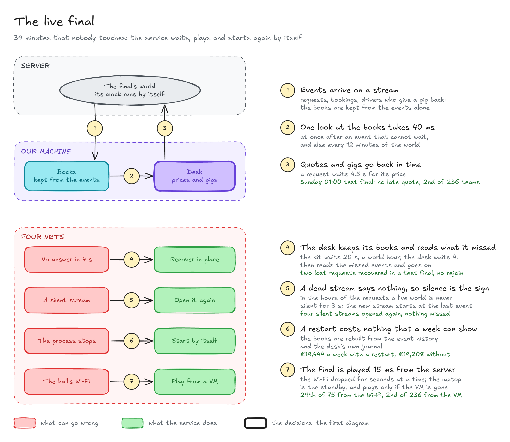

# DaVinci's Night Shift: a dispatcher for Spread

Spread is Bahn Express's challenge at Junction 2026: one simulated week of a car transport company in Finland. Dealers ask for prices, and a competitor answers them too. Each car that we win needs a freelance driver, found by posting a gig with a fee. The score is the gross margin, and a team is ranked only when at least 90% of its orders arrive on time.

**In short.** The desk makes two estimates, applies one rule and keeps one guard. Version 21 makes €16,013 a week on 80 level 8 weeks that no setting was tuned on, at 97.0% on time, with the lowest week at 92.6%. In the Sunday 01:00 test final it was second of 236 teams. Every idea was measured on the same weeks with it and without it: the 11,651 practice weeks are in `results/runs.csv` under 272 labels, and what did not work is listed below with its number.

<picture><source media="(prefers-color-scheme: dark)" srcset="docs/diagrams/how-the-desk-decides.dark.png"></picture>

This repository is our system (`desk/`), the harness that measures it (`eval/`), the log of every week it has played (`results/runs.csv`), and a page that replays a week on a map of Finland and shows the evidence with charts (`ui/index.html`: open it in a browser).

<picture><source media="(prefers-color-scheme: dark)" srcset="docs/control-room.dark.png"></picture>

| To read about | Go to |
|---|---|
| What it scores, version by version | [Result](#result) |
| The two estimates, the rule, and each idea with its measured effect | [How it decides](#how-it-decides) |
| The rule that an idea must pass to become a default | [How an idea becomes a default](#how-an-idea-becomes-a-default) |
| More than sixty ideas that were measured and left out | [What did not work](#what-did-not-work) |
| The live final, and what happens when the network fails | [Robustness](#robustness) |

## Result

Level 8, mean margin a week on the same 20 practice weeks (`eval-01` to `eval-20`). Each row adds to the one above.

| Version | What it adds | Margin a week | On time | Lowest week |
|---|---|---|---|---|
| `starter` | The kit starter | −€66,760 | 51.0% | 38.3% |
| `v2` | Prices by expected profit, from two fitted curves | €9,039 | 96.3% | 91.8% |
| `v5-notes` | A reader for the dealers' notes | €11,725 | 96.6% | 92.7% |
| `v8` | Return-trip pairs, the day with few drivers, the guard | €12,963 | 97.5% | 94.3% |
| `v9` | A wider radius for pairs | €14,027 | 97.7% | 95.5% |
| `v11` | Prices 6% above the curve's choice | €14,785 | 98.1% | 95.6% |
| `v12` | No low prices to buy trust; a lower minimum chance | €16,177 | 97.4% | 95.2% |
| `v13` | Fee raises before the last hours | €16,467 | 97.7% | 93.0% |
| `v15` | Riskier cars while the week has on-time share to spare | €17,384 | 97.2% | 92.8% |
| `v16` | Trade-ins | €17,363 | 97.1% | 93.1% |
| `v17` | A market learner that follows the competitor's own moves | €17,408 | 96.8% | 93.6% |
| `v18` | The easiest cars open at a lower fee | €17,508 | 97.2% | 93.3% |
| `v19` | A morning alarm for cars that sit; the safest cars still pass once the guard's allowance is spent | €17,416 | 97.1% | 93.3% |
| `v20` | The guard's reserve for a bad day follows what the week can still bring | €17,431 | 97.1% | 93.3% |

On weeks that no setting was tuned on, `v18` makes €17,690 a week at 97.4% on time (20 weeks, `hold-01` to `hold-20`, lowest week 93.7%).

A gain of a few hundred euros a week does not show on 40 weeks: there the standard error of a difference is €150 to €200. So 80 more weeks (`more-01` to `more-80`) judge the last two steps. On all 120 weeks:

| Version | Margin a week | On time | Lowest week | Late cars a week |
|---|---|---|---|---|
| `v16` | €16,709 | 96.7% | 91.6% | 13.0 |
| `v17` | €17,023 | 96.9% | 91.5% | 12.2 |
| `v18` | €17,256 | 97.2% | 93.2% | 11.3 |
| `v19` | €17,263 | 97.2% | 93.2% | 11.4 |
| `v20` | €17,423 | 97.1% | 92.8% | 11.7 |

`v17` makes €314 a week more than `v16` (standard error €105), and `v18` €233 more than `v17` (standard error €99). Together: €546 (standard error €125), better on 80 of the 120 weeks. All 120 weeks are ranked.

`v19` adds nothing on average (€7 a week, standard error €36): it is insurance for a kind of week, described below.

`v20` makes €160 a week more than `v19` on these 120 weeks. Its gain does not show on the first 20: it sits in the one week in five that has no night of dropped bookings, and only one of those 20 is such a week.

By Saturday evening the 80 `more` weeks had judged dozens of settings, so they flatter the survivors too. `v20` was therefore judged once on 80 weeks that no setting had seen (`check-01` to `check-80`):

| Version | Margin a week on the unseen weeks | On time | Lowest week |
|---|---|---|---|
| `v19` | €15,789 | 97.1% | 92.6% |
| `v20` | €15,970 | 97.0% | 92.6% |

The difference is €181 a week (standard error €59). Over all 200 weeks it is €169 (standard error €37), all 200 are ranked, and the lowest week is the same in both. The level on the unseen weeks, about €16,000, is the one to expect in the final.

`v21` raises one number, the cap on our orders without a driver, from 60 to 80. After `v20`'s rule for cars due after the weekend, that cap stopped all pricing on Friday afternoons, when most of the cars that wait are due on Monday. On the 80 `more` weeks it makes €137 a week more (standard error €37), on the 80 unseen weeks €43 more: over the 160, €90 (standard error €23), better in 29 weeks and worse in 1, the lowest week unchanged. No cap at all gives the same as 80 (`mw-80`, `mw-70`, `mw-100`, `mw-none`).

The 40 weeks that the settings were tuned on flatter them. `v18` makes €17,599 a week on those 40 and €17,084 on the 80 new ones, at 97.1% on time. The second number is the one to expect. The rhythm test under Robustness shows the same thing from another side: on the tuned weeks, any change of rhythm looks like a loss.

Ranking rounds at level 8, five secret weeks each:

| Round | Version | Five weeks | On time |
|---|---|---|---|
| Saturday 00:00 | `v11` | €74,742 | 97.6% |
| Saturday 09:00 | `v16` | €77,573 | 97.2% |
| Saturday 12:00 | `v17` | €99,211 | 97.8% |
| Saturday 15:00 | `v18` | €89,578 | 97.1% |
| Saturday 18:00 | `v19` | €78,279 | 97.0% |
| Saturday 21:00 | `v20` | €91,134 | 97.8% |
| Sunday 00:00 | `v21` | €87,687 | 97.2% |

In the Saturday 09:00 round this was the second highest total of the 68 teams that played it. The highest was €79,003. In the Saturday 12:00 round it was the highest of the 34 teams that had finished when we played, at 12:34. The second was €98,990. When the round closed we were second of 64: one team had reached €110,267. In the Saturday 15:00 round we were second of the 42 teams that had finished when we played, and sixth of 79 when it closed: the highest total was €107,104. Four of its weeks placed us 4th, 3rd, 9th and 4th. The third placed us 32nd of the 64 ranked teams, and it is the reason for `v19`. In the Saturday 18:00 round `v19` had the highest total of the 9 teams that had finished when we played, at 18:03, and the highest margin in each of the five weeks. The weeks of this round are poorer; when it closed we were seventh of 67 ranked teams, with €94,445 at the top. The Saturday 21:00 round was played from the VM with `v20`, in one minute: fifth of 56 ranked teams when we played, behind €105,424, €96,850, €94,298 and €92,267, and 7th, 2nd, 7th, 19th and 5th in its five weeks. The 19th is a rich week whose day with few drivers came on Friday: the guard held 68 options back on Thursday, and the week ended at 98.8% on time. That week also showed the next rule that held orders back, a cap on the orders without a driver, which became `v21`. The Sunday 00:00 round was played with it: third of the 40 ranked teams when we played, behind €102,582 and €89,161, and 2nd, 3rd, 5th, 2nd and 4th in its five weeks.

The same code, not tuned for them, also played the Saturday 12:00 round at levels 2 to 7, and every week is ranked: first of 19 at level 7 (€54,251), third of 8 at level 5, fourth at levels 2, 3 and 4, and 13th of 18 at level 6. Level 1 was not played: there the desk is at 89% on time in practice.

## How it decides

Two estimates, and one rule that uses them.

**The chance that a driver takes a car in time.** A logistic curve on what a dispatcher knows at the quote: the awake hours until the last pickup, the length of the drive, the fee over the typical fee, the drivers who live within 100 km of each end, and how many of our orders already wait for a driver. It is fitted on 29,597 orders from 80 weeks that we played with random prices and fees (`analysis/fit.py`).

**The chance that a dealer takes a price.** A logistic curve in the log of the price over the list price, divided by the dealer's trust: 1% for each order that we delivered to it on time, as the rules say and as the fit confirms. Each lane has a level that holds in every world. The day's level does not hold: the desk learns it from each quote that wins or loses, one step of Bayes at a time, and widens its belief each morning. A price war shows as a low level within the first quotes of its day. The same step of Bayes also learns this week's own parts of the competitor's prices: a tilt by the lane's length, and a level for each pickup place and each delivery place.

**The rule.** For each option of a request, the desk picks the opening fee with the lowest expected cost among the fees at which a driver comes in time often enough. Then it quotes the price with the highest expected profit: the chance that the dealer takes it, times what it leaves after that cost. An option without such a fee gets no price.

On top of that, each idea below has a reason and a measured effect, on the same weeks with and without it.

| Idea | Why | Effect a week |
|---|---|---|
| Read the notes | A note can move the ready time, the real opening hours, the deadline, or ask for plates or a manual licence. The world acts on it. The reader gets 99.97% of 3,963 unseen notes right, and says when it is unsure. | +€1,850; failed visits fall from €515 to €5 |
| A gig covers one day when the note gives hours | A stop's window is one stretch of time, and opening hours hold every day. | part of the row above |
| Return-trip pairs | Two cars in one gig, the second starting within 60 minutes of the first's delivery and ending within 120 minutes of its pickup. The driver needs no trip to a pickup and no trip home, so the pair goes at 0.75 of the two typical fees. 78% are booked within an hour. | +€1,224, then +€1,064 for the wider radius |
| The day with few drivers | In every week, on one night, 8 to 24 drivers give their bookings back just after midnight. That day causes 40% of all late cars. The desk sees the burst, stops pricing cars that need a pickup that day, and raises the fees of the day's cars in the morning. | on time 96.4% to 96.9%, margin unchanged |
| The guard | Up to a quarter of the cars due on such a day are late. So the desk never holds more cars due on one day than the week can afford to lose a quarter of. | lowest of 40 weeks: 91.3% to 94.1%, margin unchanged |
| Prices 6% above the curve's choice | A 6% higher price lost 13% of the orders, where the curve said 24%. | +€758 |
| No low prices to buy trust | Pricing low to win an order and its trust point loses more than the trust returns. | +€368 |
| A lower minimum chance | The curve is cautious: it says 94.7% in time where 97.3% are. So the desk asks it for 0.84, not 0.90, and lets more orders wait for a driver. | +€1,024 on top of the row above |
| Fee raises before the last hours | A gig that is not taken at its opening fee goes up in two steps before the steep last hours. | +€448, and more cars on time |
| Riskier cars while there is room | Long lanes earn €80 to €100 a car. The desk takes them, and others, at a lower chance only while the week's late share is under 3%. | +€367 and +€345 |
| The competitor's own moves | The handbook says how the competitor's prices move in a week: once, its price list changes shape, so short and long lanes move in opposite directions, and some mornings its prices for cars leaving a place, or arriving there, move a step. The learner has one part for each. On 80 weeks with random prices it predicts the next answer 3.9% better. | +€314 on 120 weeks, and 0.8 fewer late cars a week |
| The easiest cars open lower | In 80 weeks with random opening fees, the cars of which 94 in 100 book at 0.85 of the typical fee cost 0.85 in the end when they opened at 0.70, and 0.93 when they opened at 0.85. For other cars a lower opening fee saves nothing and makes more of them late. So only these cars may open at 0.72. Their expected cost falls, so does their price, and the desk wins more of them. | +€233 on 120 weeks, 0.9 fewer late cars a week, lowest week 91.5% to 93.2% |
| A morning alarm, and no full stop | In the third week of the Saturday 15:00 round drivers were scarce from Monday: 42 cars had no driver on Monday night, where the most in 120 practice weeks is 37. By Wednesday 25 of 241 cars were late, without the night of dropped bookings that the desk watches for. The guard's allowance was spent, and on Friday the desk priced 3 requests: ranked at 93.3%, and 32nd of the 64 ranked teams. So when 35 cars still wait at 06:00, the fees of the cars due that day rise early, as after a night of drops. And once the allowance is spent, a car that is 95% sure of a driver in time is still priced: it raises the on-time share. | The alarm rang in 6 of 80 new weeks. The one in which the guard had nearly closed made €4,002 more and went from 93.2% to 95.6% on time; over 120 weeks €7 more, every week ranked. The second rule changed no practice week |
| The reserve follows what the week can still bring | In the Saturday 18:00 round we were first over five weeks and only 12th and 10th in two of them: the guard's limit had turned 183 and 65 options away, and those weeks still ended at 96% and 98% on time. A diagnostic that writes down why each request is declined (it changes no result) showed where the limit costs. Of the 235 requests a week that the desk declines, 131 are worth €1 each by the models and 36 have no driver in time. But 37 are good cars over the day's limit: a driver in time for 88 in 100, €26 of expected profit each, and most are Friday's requests for cars due on Monday. The reveals say what those cars risk: 3% are late, 11% in the worst of 40 weeks, with or without a night of drops on that Monday. They have the weekend to find a driver. So cars due after the weekend get a reserve of 10%, not 25%. And every week that a smaller reserve hurt had 28 or more cars without a driver at some midnight before its bad day: a week that stays under 26 at every midnight reserves 15%. | +€169 on 200 weeks (standard error €37), +€181 on the 80 unseen ones; the lowest week unchanged at 92.6%. The first rule alone: +€125, better in 31 weeks and worse in 4. In the weeks with no night of drops: +€550 to +€920 |
| Trade-ins | Their list price is 1.9 times the typical fee, against 1.1 for other cars. The world lets a driver bring the new car after the customer's booked hour, so the gig carries its own window on that stop: 94% arrive inside it. | +€204 |

## How an idea becomes a default

<picture><source media="(prefers-color-scheme: dark)" srcset="docs/diagrams/how-an-idea-becomes-a-default.dark.png"></picture>

A practice week is deterministic: the same seed, level and actions give the same week to the cent. So an idea is a setting that is off, played on the same 80 weeks with it and without it, and each week is compared with itself (`eval.run`, `eval.compare`).

- The gain must be more than twice its standard error. One cent less on every fee step moved one week by €1,354, so a smaller difference is noise.
- The lowest week's on-time share must not fall. The final is one week, and under 90% on time a team is not ranked.
- Then 80 weeks that no setting has seen judge the change once (`check-01` to `check-80`). The weeks that judged dozens of settings flatter the survivors.

Only then the setting becomes the default, and plays the next ranking round. The page `ui/index.html` shows ten of these comparisons week by week, five that were kept and five that were not.

## What did not work

Each of these is in `results/runs.csv` under the label in brackets, and is off in the settings.

- Direct offers to a driver who has just delivered near an open gig: none of 6,491 offers was accepted (`explore-offers`).
- A detector for the region where the competitor is down for a day: it finds the region in 18 of 20 weeks, but mostly in the afternoon, too late to earn (`v9-outage`).
- A lower fee for a gig's first minutes (`i-*`), and a higher fee right after a driver gives a gig back (`o-drop*`).
- A lower price when the car pairs with a waiting order: the pair seldom forms (`v10-pairquote`).
- A level for each dealer (`d-sd*`), a price factor by lane length (`h-*`), a dearer same-day option (`o-fast*`), a flatter or steeper dealer curve (`k-*`).
- Driver curves with products of their features: they rank orders better on paper (AUC 0.869 against 0.851) and make less in play (`v17b`, `n-*`).
- Two beliefs about the day's price level each morning, an ordinary day and a price war day: €430 to €640 a week less than the single belief that starts from yesterday (`m-regimes*`).
- A pickup window that ends before the last pickup minute, so that a drive that runs long still ends in time: no more cars on time, €120 to €235 a week less (`b-*`).
- A lower minimum chance for private addresses (`pv-*`), and other shapes of the fee raises (`r-*`).
- A new car that stays off the app for 30 to 120 minutes, so that a return car that we win later still finds it as a partner: 15 more pairs a week, and €65 to €314 a week less. A pair saves little against two easy cars, which book alone at 0.85 of the typical fee (`pi-*`).
- Town effects in the driver curves: 1.3% better on paper, no gain on 120 weeks (`t-towns`).
- Direct offers to the drivers who looked at a gig and did not book it: 15 of 959 were accepted, and 2 of 331 at the fee in the app. A driver who looks and leaves needs a higher fee (`w-vo-smoke`).
- A driver level learned during the week, as the dealers' level is: it predicts the next gigs worse than the fixed curve, because a quick booking is known at once and a gig without a driver only hours later.
- A lower or a higher price factor with the new learner: €321 and €489 a week less (`qg-103`, `qg-109`).
- A guard that counts on fewer orders when the week wins them at a slow pace: it changed 5 of 80 weeks and did not lift the lowest ones (`qp-pace`).
- The week's two unannounced events as cases of their own: a price war day and an outage day in one region, each weighed by every answer (an idea from another team's public notes, built here from scratch). It foretells the next answer 3.1% better on the randomised weeks and makes €7 a week less in play, with a standard error of €99 (`qv-ev`).
- A price factor that follows the market's level, lower in a week with a cheap competitor: 19 more orders in the cheapest quarter of weeks and no more margin; €202 a week less over all weeks (`gl-02`).
- A tighter guard, 95% in the worst case: €477 a week less, on time 0.3 points up, the lowest week no higher (`gd-95`). And no risk budget at all: €578 less (`ab-nospare`).
- A looser guard, to win more in the weeks with a dear competitor, where the day's limit turns 62 options a week away. At 93% in the worst case: €197 a week more, and the hardest week falls from 94.4% to 90.9% on time. Counting on a fast week's pace: €154 more, and the same week at 90.7% (`gf-93`, `ga-up`). A final is one week: not taken.
- The same smaller reserve, 15%, for every week and every day: €171 a week more, and four of 80 weeks under 93% on time, one at 90.9%. Split by the weekday of the night of drops it gains €1,046 a week where no such night comes, nothing where it comes on Friday, and loses €321 where it comes on Thursday (`gl-15`). A smaller reserve pays only where the bad day has passed or the week is calm: that is `v20`.
- A sign of the day with few drivers in how many drivers look at our gigs: there is none (1.04 of the week's median day on such a day). A bad Monday, when we hold no bookings that drivers could give back, cannot be seen, and Monday's own backlog does not show it either.
- The competitor's morning move for each dealer, which the handbook describes: a dealer whose requests we all won the day before answers as if our prices were 1.5% higher. Too small for a part of its own.
- Settings chosen on the first 40 weeks, tried again on fresh ones against `v19`: steeper fee steps on the day with few drivers €270 a week less, a lower fee for pairs €168 less, a lower minimum chance while there is room €150 less, a shorter slack €72 more with a standard error of €110 (`sd-steep`, `pf-72`, `sc-75`, `sl-20`). They stay as they are.
- A car priced with its lane's expected pair saving. A car in a return-trip pair costs 0.76 of its typical fee and a car alone 1.03, and the share of a lane's cars that pair runs from 3% to 45% and holds from week to week (`analysis/pairs.py`). So the desk took that saving off the cost of cars on lanes that pair. It is a dial for orders, not for margin: 14, 26 and 41 more orders a week at half, the whole and one and a half times the saving, and €69 to €85 a week less, inside the noise, with the on-time share 0.3 points lower (`pp-05`, `pp-10`, `pp-15`). The public feed of a test final says why: the leader's revenue and cost an order equal ours (€102.5 and €60.7 against €102.2 and €59.5), so there was no cheaper car to find.
- A price factor that follows our backlog, lower while few cars wait for a driver: 4 more orders a week and €123 a week less (`ql-a`). A lower factor for cars due after the weekend: €193 less (`qw-103`).
- Anything that the dealer curve might miss. On the 80 weeks with random prices, no fact about a request shifts a dealer's answer by more than 1% of price: not the car, a private address, a note, a batch, the hour or the list price. A level for each lane, beyond its two places, predicts worse on weeks that it was not fitted on.
- Ideas of Saturday night from a teammate, Roman Petrov, each measured against `v20` on the 80 `more` weeks unless a screen of 16 to 20 weeks already failed (the numbers of his own runs are in the team's issues):
  - The dealer's lost trust counted only from the car's deadline on, for requests that the desk would decline: €76 a week more (standard error €101) and the lowest week at 91.7% on time. For cars due after the weekend only: €32 more (standard error €48), the lowest week at 93.6% (`rp-trust-rescue-fixed`, `rp-trust-after-weekend`). The accounting is right and worth little: the requests that it reopens are mostly lost to the competitor anyway.
  - The driver's fee, and then also the cost that prices the car, taken from the lane's usual fee instead of the published one, which has fresh noise for each request. An opening fee is taken 43% of the time when the published fee is 10% under the lane's median and 81% when it is 10% over. In play: €42 and €28 a week more, standard errors €104 and €99 (`rp-fee-lane-anchor`, `an-both`). The raises correct a fee that opened too low, so the noise costs time more than money.
  - Prices 3% lower on Monday and Tuesday only: 16 more orders a week and €255 less (`rp-early-week-price`). The learner fed with the first option's price for wins and losses alike: €336 less (`rp-learn-fastest`). A level for each route learned within the week: it foretells the next answer 3% better and makes €389 less on 20 weeks. Pairs that include a car with a note: one week at 89.1% on time, not ranked. A menu with the fastest option only, raises that wait for the car to be ready, a smaller risk provision, extra Friday offers, summer-tyre cars in clear weather: none gained.
  - One cent less on every fee step moved one week by €1,354: a single changed booking changes the rest of a week. That is why a difference under twice its standard error on 80 weeks counts as nothing here.
- A lower threshold for the cars that still pass once the guard's allowance is spent, 0.90 for 0.95. In `v20`'s own weeks it changes one week of 200. In a stress test with prices 3% lower it acts in 4 of 80 weeks, and in all four the on-time share falls by 0.2 to 0.4 points; the margin rises in one of them (`gz-90`, `zs-base`, `zs-fix`). The teammate found on the way that at the exact edge the allowance is 1.8e-14 instead of zero in floating point, so the rule for a spent allowance did not run there; the fix is in the code as `guard_zero`, off, because with 0.95 it changes almost nothing.
- Pricing the same-day cars on the day with few drivers after all: €223 a week less (`sq-on`). A lower least profit, 50 cents, and a minimum chance of 0.82: no change that 80 weeks can show (`mp-50`, `mc-82`).
- After the Sunday 01:00 test final, its public feed showed where the leaders' orders come from: the nine other teams of the first ten won their most orders on the day with few drivers, and we our fewest (73, against 92 to 115). So three ways to take more of that day were measured on the 80 `more` weeks against `v21`. Prices for that day's cars after all, at a higher opening fee and a lower minimum chance (branch `test-shortday`): €6 a week more at best, and €298 less with the widest opening (`sd-90`, `so-100`). A guard that aims at 92% or at 90% on time in the worst case, where it aims at 94%: €3 and €26 a week less, and at 90% one week of 80 ends at 88.6%, not ranked (`gt-92`, `gt-90`). Both together: €146 less (standard error €81), the lowest week at 90.1% (`gt-92-so`). In our desk the late cars of that day cost more than its orders earn, so the guard stays as it is.
- The dealer curve's shape refitted by price band (branch `test-shape`): €149 a week less, and the lowest week at 90.8% on time (`ds-on`).
- The morning alarm with the day's quotes stopped as well, at 30 cars, or as a sign to the guard that the week's bad day has come: the last left one week at 88%, not ranked (`bb-35`, `bb-30`, `ba-35`).
- A higher opening fee, 1.00, for the cars that book least easily. The randomised weeks, which had no fee raises before the last hours, said it would get more of them a driver in time. With our two raises it does not: €292 a week less, on time unchanged (`qh-75`).
- A level for each dealer in the new learner: no gain, as before (`qd-03`).
- The lower opening fee for other shares than 94 in 100. From 97 in 100: no gain. From 90 in 100: €59 a week, and one of 79 weeks falls to 89.3% on time. From 85 in 100: €111 a week less (`qe-97`, `qe-90`, `qe-85`). The randomised weeks say the same: below 94 in 100 a lower opening fee saves nothing.

## What would break it

- The curves are fitted on level 8 weeks. At other levels the desk is ranked but not tuned.
- The guard assumes one day with few drivers a week and a loss of a quarter of that day's cars: 15% in a calm week, 10% for cars due after the weekend. Two such days, or a worse one, would cost on-time share.
- The network. On Saturday evening the hall's Wi-Fi dropped for seconds at a time, and it cost a test final 90 orders before the live loop was hardened (see Robustness). Each drop still costs the requests of its seconds, so the final is played from a machine in a data centre near the server, and the laptop is the standby.
- A week in which drivers are scarce from its first day. The practice weeks hold none as hard as the one of the Saturday 15:00 round, so `v19`'s two rules for it are tested on the weeks nearest to it, not on it.

## Run it

Python 3.9 or later. The team key goes in `.env`, which git ignores.

```sh
python3 -m venv .venv
.venv/bin/pip install context/02-kits/spread-0.1.0-py3-none-any.whl pandas scikit-learn
printf 'SPREAD_URL=https://spread.bahnexpress.com\nSPREAD_KEY=<team key>\n' > .env

.venv/bin/python dispatch.py --level 8 --seed eval-01          # one practice week
.venv/bin/python -m eval.run --label try --set l8              # the 20 tuning weeks, 8 at a time
.venv/bin/python -m eval.compare v18 try                       # week by week against a version in the log
./play_ranking_round.sh 8                                      # the five weeks of the current ranking round
./run_final.sh                                                 # the final or a test final: waits, plays, restarts itself

.venv/bin/python -m unittest discover -s tests                 # the tests of the live loop and the guard
python3 ui/build.py                                            # the page, from the log: ui/index.html
python3 docs/diagrams/draw.py                                  # the three diagrams, as Excalidraw scenes
```

`pandas` and `scikit-learn` are needed only for `analysis/`. The desk itself uses the kit and the standard library.

## What is where

| Path | What it is |
|---|---|
| `desk/desk.py` | The decisions, and every setting with the measurement behind it |
| `desk/books.py` | What the desk knows, kept from the world's events alone |
| `desk/model.py`, `desk/fitted.json` | The driver curves and their coefficients |
| `desk/market.py` | The dealer curve and the day's level |
| `desk/notes.py`, `desk/words.txt` | The note reader, and the words that it repairs typos against |
| `desk/play.py`, `desk/live.py` | The loops: a practice world, and the live final |
| `eval/` | The harness: fixed weeks, parallel runs, the log, the comparison |
| `analysis/` | Fits the curves, scores the note reader |
| `tests/` | Tests of the live loop's recovery, the stream's time limit, the dealer curve and the guard |
| `results/runs.csv` | One row for each week played: 11,651 weeks under 272 labels |
| `results/test-final-sunday-0100.csv` | The public feed of the Sunday 01:00 test final as we recorded it: the first ten teams, hour by hour |
| `results/replay.json` | One week of version 21 (`check-35`) as the page's map replays it: each request, each car's four moments, the margin as it grew. `analysis/replay.py` writes it from the world's event history |
| `ui/` | The page: `build.py` computes every number from the log, `page.html` is the layout, `index.html` the result, `finland.json` the country's outline (Natural Earth, public domain) |
| `docs/diagrams/` | The three diagrams: `draw.py` writes the Excalidraw scenes, from which the PNG and SVG files are rendered, each for a light and a dark page |
| `RUNBOOK.md` | The morning of the final, step by step |
| `AGENTS.md` | The rules for a teammate's coding agent: what protects the final, and what counts as evidence |
| `context/` | The challenge's rules, handbook and kits, and our first notes |

## Robustness

<picture><source media="(prefers-color-scheme: dark)" srcset="docs/diagrams/the-live-final.dark.png"></picture>

- The desk rebuilds its books from the world's event history and its own list of orders and gigs. With lost requests and lost answers injected into every kind of call, four weeks scored the same as without (`flaky` tests).
- The live loop played the Saturday 14:00 test final, a week joined on Thursday: 9th of 55 ranked teams, €3,375, 98.5% on time, no failed look and no late quote.
- The Saturday 20:00 test final, a full week, showed what a bad network does. The hall's Wi-Fi lost a request every minute or two. The kit waits 20 seconds for an answer, a world hour, and the desk then joined its world again from nothing: Monday ended with 66 orders, where an ordinary Monday has about 110. We finished 29th of 75 ranked teams with €15,129 at 99.2% on time, 35 orders short of the tenth place, with the same margin an order as the leaders. Three changes went into the running final, each by a restart of the desk, which is itself a test of the restart:
  - A request in play waits 4 seconds for its answer, not 20. When none comes, the desk keeps its books, reads the events that it missed and the world's own list of our orders and gigs, and goes on. It joins the world again from nothing only when that fails three times.
  - The final's clock is read in the background on a connection of its own, so a read without an answer holds no quote up.
  - The kit's stream says "no event" for as long as nothing comes, also when its connection has died without a word. In the hours of the requests a live world is never silent for three seconds, so after three the desk opens the stream again from its last event, which misses nothing.

  After them, on the same network: Thursday 97 orders and Friday 59, no rejoin, two lost requests recovered in place and four silent streams opened again. The desk also keeps the server's address after its first request, because the hall's name server failed for seconds at a time.
- The Sunday 01:00 test final, a full week, was played by `v21` from the VM: second of 236 teams (41 ranked), €13,672 with 371 orders at 96.8% on time, behind €14,112 and ahead of the team that leads every ranking round. No late quote, no lost request and no rejoin in the whole week. Five hours earlier the same loop, from the hall's Wi-Fi, was 29th.
- The final is played from a VM in a data centre, 15 ms from the server (19 ms at worst in 40 requests), by a service that starts by itself. Full weeks played live there with a restart in the middle of each make what practice says: €21,828, €19,278, €18,962 and €19,733 on weeks that make €22,258, €18,125, €18,268 and €19,579 in practice mode, with no failed look and at most one late quote.
- Three more changes to the final's code came from the teammate's review that night, each checked by tests in `tests/`, by eight practice weeks that give `v20`'s margin to the cent, and by a live week with a restart: a car whose pickup failed in a pair no longer keeps its old gig as carrier after a recovery; the dealer curve is computed once for each option, not once for each price, which more than halves the time of a decision; and the kit's stream waits at most 5 seconds for its handshake or for the rest of a frame, where its own limit is 300.
- Full weeks played live on practice worlds whose clock moves at the final's pace, or three times as fast: without a restart €19,208 a week on four weeks that make €19,033 in practice mode; with one restart in the middle of each, €19,444. A restart costs nothing that these weeks can show.
- `v20` played a full week live on a practice world at six times the final's pace while the hall's network dropped three times, with one planned restart across a midnight: €17,362 at 97.4% on time, on a week that makes €18,125 in practice mode and €16,235 with `v19`. The midnight counts that its calm-week rule needs are in the journal, and a desk that starts again reads them back; when one is missing, the week counts as not calm.
- One look at the books takes 40 ms on average and 0.33 s at worst. A request waits 4.5 s.
- The live loop keeps the rhythm of the practice weeks: a look at once after an event that cannot wait, and else every 12 minutes of the world. Every measurement here was made at that rhythm, so the final plays at it too. A quote never waits past 6 world minutes before its deadline. How much the rhythm itself is worth is not settled: on the 40 weeks that the settings were tuned on, a look every 3, 9 or 10 minutes makes €200 to €400 a week less, but on 80 fresh weeks a look every 10 minutes makes €127 less with a standard error of €138 (`qt-3`, `qt-9`, `qt-10`).
